  

> **Building Practical Software through Code, Data, and Engineering.**

## About Me

I'm a Physics student interested in **Software Development** and **Data Analytics**, with a focus on building practical projects and continuously improving through hands-on learning.
Currently exploring software engineering, data analysis, and problem-solving through real-world projects.

## Connect

[LinkedIn](https://www.linkedin.com/in/galuh-kurnia-pratama-a25b9b325) · [Instagram](https://www.instagram.com/galhkoernia_/) · [Email](mailto:galuhkoernia@gmail.com)

---
Always learning, building, and exploring.
